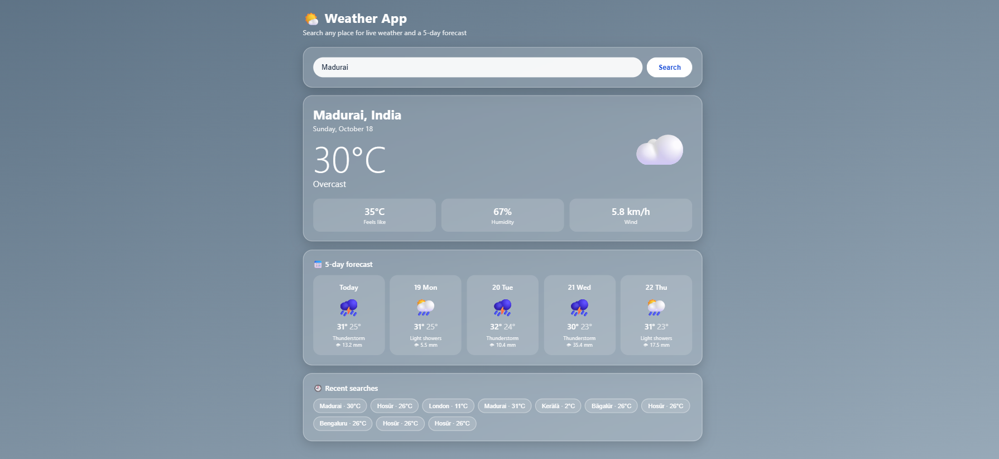

# Weather App (Flask + Open-Meteo + MySQL)

Type a city, see the current weather and a 5-day forecast. Every search is saved in MySQL.

## Run it (one step at a time)
1. Open this folder in VS Code (File > Open Folder > weather-app).
2. Terminal > New Terminal.
3. `python -m venv venv`
4. `venv\Scripts\activate`  (you should see (venv) in the prompt)
5. `pip install -r requirements.txt`
6. Open `config.py` and change `your_mysql_password` to your MySQL root password.
   (No MySQL yet? Skip this. The app still works, it just won't save history.)
7. `python app.py`
8. Open http://127.0.0.1:5000 in your browser.

## Files
- app.py: the Flask server and the two API routes
- weather_service.py: gets the data from Open-Meteo
- db.py: saves and reads search history in MySQL
- templates/index.html: the web page
- config.py: MySQL settings
